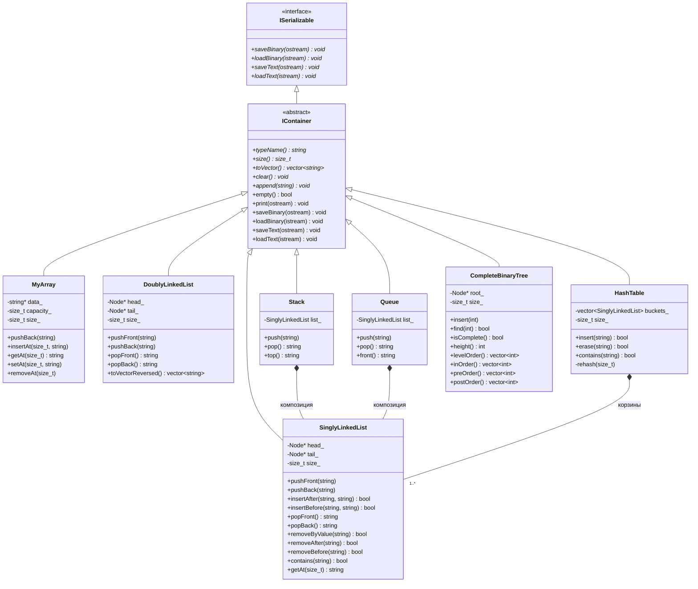
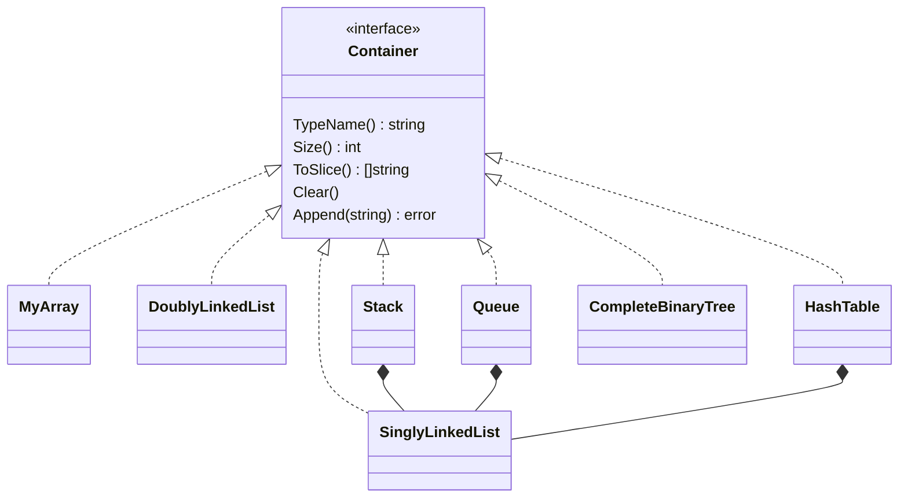

# UML-диаграммы классов

## C++ (пространство имён `lr3`)

## Go (пакет `ds`)

В Go наследования нет: `Container` — интерфейс, который неявно реализуют все типы; сериализация — функции
пакета (`SaveBinary`, `LoadBinary`, `SaveText`, `LoadText`), принимающие `Container`.

